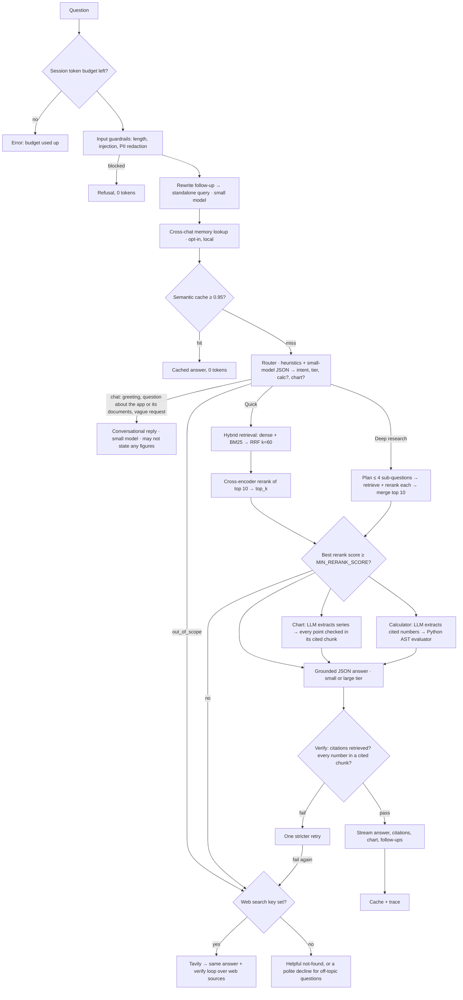

# FinCite

Grounded Q&A over company annual reports and SEC filings. Upload a report, ask questions in plain English, and get answers that cite their page. Numbers are calculated in Python, not by the LLM, and a deterministic verifier checks every figure against the cited source before the answer reaches the screen. When the documents don't support an answer, FinCite says "Not found in the provided documents" instead of guessing.

Live at https://fincite.vercel.app. The UI and the API both run on Vercel ([docs/DEPLOY.md](docs/DEPLOY.md)).

## Architecture



Every step is a plain Python function in `backend/app/pipeline/`; `orchestrator.py` runs them in order and yields typed server-sent events. There's no agent framework.

| Layer | Choice |
|---|---|
| API | FastAPI with SSE streaming of typed events (`step`, `token`, `chart`, `citations`, `suggestions`, `done`, `error`) |
| UI | Next.js 16 (App Router), React 19, TypeScript, Tailwind 4, shadcn/ui (Radix), lucide-react, recharts, sonner |
| LLM | LiteLLM locally; a slim OpenAI-compatible client (`openai` SDK) in cloud mode. Providers: OpenAI, Azure OpenAI, Anthropic, Gemini, Groq, Ollama. Small/large tiers plus a fallback chain |
| Parsing | PyMuPDF + pymupdf4llm: per-page markdown, tables kept whole, 4 parallel workers. PDF, HTML (SEC filings), TXT/MD, EPUB |
| Embeddings, BM25, rerank | Local: fastembed (bge-small-en-v1.5, Qdrant/bm25, ms-marco-MiniLM-L-6-v2) on CPU. Cloud: Jina embeddings v3 (512-d) and Jina reranker v2, plus a pure-Python BM25 |
| Vector DB | Qdrant with named `dense` and `sparse` vectors: embedded on disk locally, Qdrant Cloud when deployed |
| Storage | SQLite locally, Postgres (Neon) when deployed: users, auth sessions, documents and file pieces, chats, summaries, memories, cache, traces |
| Auth | Email + password (scrypt), opaque bearer tokens stored as SHA-256 hashes, a guest trial with credits, roles guest / user / admin |

The same code runs in two modes, chosen by `DEPLOY_MODE`. **Local** (the default) uses SQLite, embedded Qdrant and local models, and indexes in the background. **Cloud** (Vercel) uses hosted services and indexes inside the upload request. Small adapters hide the difference: `db.py`, `embeddings.py`, `ingest/indexer.py`, `llm/gateway.py`.

## Features

- **Talks like an assistant, answers like an analyst:** greetings, questions about what it can do or which documents are loaded, and requests too vague to search get a short conversational reply (or one clarifying question) instead of a search. Those replies never state company facts; code rejects any figure in them. When the documents don't support an answer, it says where it looked and how to rephrase, rather than guessing.
- **Cited answers:** every claim cites `[C#]`, shown as page chips. A citation opens the real page with the cited passage highlighted, or the extracted text.
- **Python arithmetic:** growth rates, ratios and differences are computed by a whitelisted AST evaluator from numbers that were checked against their source chunk.
- **Grounded charts:** ask "how has X changed over the years?" and get a chart. Every plotted value is checked against its cited page, and dropped points are reported.
- **Quick or Deep research:** Quick lets the router pick the small or large model per question. Deep research splits the question into sub-questions, reads more of the report and writes a structured answer with the large model. The composer shows which model will answer.
- **Executive briefing:** a one-click Deep-research overview of a report from the empty chat screen, alongside example questions.
- **Document scope:** a "Search in" picker chooses which documents a chat searches.
- **Related questions and key terms:** three suggested follow-ups after each answer, and plain-English definitions of jargon (float, GAAP, underwriting…), labelled as general definitions, never as document facts.
- **Answer actions:** Copy and Retry under every answer; export a whole thread as Markdown.
- **Chat history:** saved chats with search. Each chat has a ⋯ menu to pin, rename or delete it; pinned chats get their own section. Long chats stay fast because older turns are summarised.
- **Cross-chat memory (opt-in):** remembers lasting preferences you mention, across chats. View and delete memories in Settings.
- **Web search (Tavily, optional):** used automatically only when your documents can't answer, and clearly labelled as web content.
- **Accounts and free trial:** visitors start as a guest; signing up keeps everything from the trial. The sidebar's profile menu shows your email, links to Settings and logs you out.
- **Usage alerts and budget:** a notification when this session's tokens or estimated spend pass limits you set, and at 80% of the session token budget.
- **Insights:** cost, tokens, cache hit rate, latency per pipeline step and recent requests, from the traces.
- **Light and dark themes**, a collapsible sidebar with an icon rail, and an API status indicator that explains cold starts.

A guided tour of how everything works, with measured numbers and interview questions, is in [docs/STUDY_GUIDE.md](docs/STUDY_GUIDE.md).

## Project layout

```
backend/app/
  main.py            FastAPI routes (thin): auth, uploads, documents, chat (SSE), sessions, memories, settings, insights
  config.py          every default, overridable by env var
  auth.py            guests, accounts, bearer tokens, roles, credits
  db.py              SQLite / Postgres adapter and schema (columns added automatically on start-up)
  documents.py       upload → parse → chunk → index lifecycle, with live progress
  embeddings.py      dense, sparse and rerank models: fastembed locally, Jina in cloud mode
  sessions.py        chats, messages, rolling summary of older turns
  memory.py          opt-in cross-chat memory
  seed.py            indexes the bundled sample report
  ingest/            parser.py, chunker.py, indexer.py (Qdrant), preview.py (page images with highlights)
  retrieval/         hybrid.py (dense + BM25 → RRF), bm25.py, rerank.py
  pipeline/          orchestrator, guard_input, rewrite, router, deep, chart, calculator, answer, verify, web_search
  llm/gateway.py     tiers, fallback chain, JSON mode, cost, key masking
  llm/models.py      the chat models a key can use, from the provider's own list
  cache/             semantic cache
  obs/tracer.py      per-request traces and the Insights aggregation
api/index.py         Vercel entry point (cloud mode)
frontend/            Next.js app: app/ (routes), components/ (chat, documents, sessions, settings, insights, auth), lib/ (API client, SSE, settings)
eval/                golden set, eval runner, results and tuning log
tests/               backend tests (LLM calls are faked)
```

## Run locally

Three ways, all in local mode. No `.env` is needed: the defaults in `backend/app/config.py` work out of the box. To override any of them, put `NAME=value` lines in a `.env` at the repo root (see [Configuration](#configuration)).

**1. macOS, one click:** double-click `start.command` (or run `./start.command`). It installs anything missing (Python 3.13 and Node via Homebrew if needed), reinstalls dependencies when the requirements change, starts the API and the UI on the first free ports from 8000 and 3000, and opens the browser. Ctrl+C or closing the window stops both servers. Logs go to `logs/`.

**2. make** (macOS, Linux, or Windows with Git Bash). Requires Python 3.11+ and Node 20+. On macOS the built-in `python3` is 3.9, so run `brew install python@3.13` first; `make install` picks the newest Python it finds (override with `BASE_PY=...`).

```bash
make install            # .venv + pip install -r requirements-local.txt + npm ci
cp frontend/.env.local.example frontend/.env.local
make api                # http://localhost:8000 (interactive docs at /docs); API_PORT=8001 to change
make ui                 # http://localhost:3000
make test               # backend tests (no API key needed: LLM calls are faked)
```

**3. Docker**, with nothing installed but Docker:

```bash
docker compose up --build    # UI on :3000, API on :8000, data in the fincite-data volume
```

One `Dockerfile` builds both images (`--target api` and `--target ui`). The API image bakes the local models into their own layer, so the first question doesn't wait for downloads and code changes don't download them again. Both images run as a non-root user with a health check.

Then:
1. You start as a guest on the free trial. Sign up from the sidebar to keep your work.
2. Open **Settings**, pick a provider and paste an API key (Ollama needs none).
3. Click **Test connection**. It also loads the models your key can use.
4. Choose the small and large models from the lists, or type any model name.
5. On **Documents**, upload a PDF, HTML, TXT/MD or EPUB file. A 150-page report indexes in about 2 minutes on a laptop CPU, with live progress.
6. Ask questions in **Chat**.

To index the Berkshire Hathaway 2023 sample report as a public, read-only document: `python -m backend.app.seed`.

### Models

Each model field has a list of suggested models for the provider (checked against the providers' docs in October 2026) and accepts any name you type. **Load from your account** (and a successful **Test connection**) asks the provider which chat models your key can use right now, so retired models never appear there. Azure is the exception: its "models" are your own deployment names.

| Provider | Default small | Default large | Also suggested |
|---|---|---|---|
| OpenAI | `gpt-5.6-luna` | `gpt-5.6-terra` | `gpt-5.6-sol`, `gpt-6-luna`, `gpt-5.5`, `gpt-5.4-mini`, `gpt-5.4-nano` |
| Azure OpenAI | `gpt-5.6-luna` | `gpt-5.6-terra` | `gpt-5.6-sol`, `gpt-5.5` (deployment names) |
| Anthropic | `claude-haiku-4-5` | `claude-sonnet-5-5` | `claude-fable-5-1`, `claude-opus-5-5`, `claude-opus-5`, `claude-opus-4-8`, `claude-sonnet-5`, `claude-sonnet-4-6`, `claude-haiku-5-5` |
| Google Gemini | `gemini-3.1-flash-lite` | `gemini-3.8-flash` | `gemini-3.6-flash`, `gemini-3.1-pro-preview` |
| Groq | `openai/gpt-oss-20b` | `openai/gpt-oss-120b` | `qwen/qwen3.8-27b` (preview) |
| Ollama | `llama3.1` | `llama3.1` | `llama3.2`, `qwen3.6`, `gpt-oss:20b`, `gemma4`, `gemma3`, `deepseek-r1` |

Settings still on an earlier default pair (for example Groq's retired Llama 3.x models) move to the new defaults automatically; models you chose yourself are kept. The list lives in `frontend/lib/settings.ts`.

## Configuration

All settings live in `backend/app/config.py` and can be overridden with environment variables or a root `.env`. The ones you're most likely to change:

| Variable | Default | Purpose |
|---|---|---|
| `FRONTEND_ORIGIN` | `http://localhost:3000` | Browser origin(s) allowed by CORS, comma-separated |
| `FRONTEND_ORIGIN_REGEX` | empty | Extra allowed origins, e.g. Vercel preview URLs |
| `DATA_DIR` | `data` | SQLite file, embedded Qdrant, uploads and page previews |
| `MAX_UPLOAD_MB` | `50` | Upload size limit for accounts |
| `MIN_RERANK_SCORE` | `-6.0` | Abstain below this rerank score: only clearly off-topic results (cloud mode uses Jina's 0–1 scale) |
| `PARSE_WORKERS` | `4` | Parallel parsing processes |
| `OLLAMA_BASE_URL`, `OLLAMA_FALLBACK_MODEL` | `http://localhost:11434`, empty | Optional last-resort local model |
| `DEPLOY_MODE` | `local` | `cloud` switches to the hosted services below |
| `DATABASE_URL`, `QDRANT_URL`, `QDRANT_API_KEY`, `JINA_API_KEY` | empty | Cloud mode only |
| `ADMIN_EMAILS` | empty | Accounts that get the admin role |

The frontend needs one variable, `NEXT_PUBLIC_API_URL` (in `frontend/.env.local`), which is inlined at build time.

## Your API keys

- **LLM, fallback and Tavily keys** are stored only in the browser tab's `sessionStorage`. They are never put in `localStorage` or cookies, and they disappear when the tab closes or when you log out. A guest who signs up or logs in keeps them in that tab.
- They are sent per request (`X-LLM-Key`, `X-LLM-Fallback-Key`, `X-Search-Key`), used for that request only, never written to disk or logs, and masked out of any error text returned to the UI.
- **Non-secret preferences** (provider, models, toggles, alert limits) belong to whoever is using the app: a signed-in account keeps them in `localStorage` under its own id, while a guest keeps them in `sessionStorage`, so every new guest, tab or window starts from clean defaults.
- CORS allows only `FRONTEND_ORIGIN` (plus `FRONTEND_ORIGIN_REGEX`, and this machine's own LAN addresses for a localhost origin).

## Accounts, credits and roles

| | Guest (automatic) | Account (email + password) | Admin (listed in `ADMIN_EMAILS`) |
|---|---|---|---|
| Questions | 5 in total | 200 per month | Unlimited |
| Documents | 1, up to 10 MB | 20, up to `MAX_UPLOAD_MB` each | Unlimited count, up to `MAX_UPLOAD_MB` each; sees every document |
| Session length | 7 days | 30 days | 30 days |
| Extras | | | `/admin/users`, credit reset, `/retrieve`, Insights across all users |

- **Sign-up upgrades the guest in place**, so trial chats and documents carry over. Logging in from a guest session merges the guest's data into the account.
- **Tokens:** opaque random 256-bit bearer tokens, kept in the browser's `localStorage`, stored on the server only as SHA-256 hashes and revoked on log-out. Passwords use scrypt and need 10+ characters with an uppercase letter and a digit.
- **Abuse limits:** guest creation per IP per hour, login attempts per 15 minutes, and one generic "wrong email or password" error.
- **Credits:** a question is charged atomically before it runs and refunded if the answer fails. An empty allowance returns 402, and the UI opens the sign-up dialog.
- **Isolation:** every query is scoped to the owner. Another user's document, chat or page image returns 404, so ids can't be probed. The bundled sample report is public and read-only.
- **Browser headers:** a strict Content-Security-Policy in production, plus `X-Frame-Options: DENY`, `nosniff` and a tight Referrer-Policy on both the UI and the API.

Limits can be overridden with env vars: `GUEST_QUESTIONS`, `GUEST_DOCUMENTS`, `GUEST_UPLOAD_MB`, `USER_QUESTIONS_PER_MONTH`, `USER_DOCUMENTS`, `SESSION_DAYS`, `GUEST_SESSION_DAYS`, `GUESTS_PER_IP_PER_HOUR`, `LOGIN_ATTEMPTS_PER_15MIN`.

## API

Interactive docs are at `/docs` on a running API. Every route except `/health` and `/auth/*` needs `Authorization: Bearer <token>`; the UI creates a guest session automatically.

| Route | Purpose |
|---|---|
| `POST /auth/guest`, `/auth/signup`, `/auth/login`, `/auth/logout`, `GET /auth/me` | Sessions and accounts |
| `POST /uploads`, `PUT /uploads/{id}/{seq}`, `POST /uploads/{id}/complete` | Chunked upload (≤ 4 MB pieces), then indexing |
| `POST /documents` | Single-request upload (local use) |
| `GET /documents`, `DELETE /documents/{id}`, `GET /documents/{id}/pages/{n}.png?highlight=…` | List, delete, page image with highlight |
| `POST /chat` | Ask a question; streams SSE events |
| `GET/POST /sessions`, `GET/PATCH/DELETE /sessions/{id}`, `DELETE /sessions` | Chats: list and search, create, open, rename or pin, delete |
| `GET /memories`, `DELETE /memories/{id}`, `DELETE /memories` | Cross-chat memory |
| `POST /settings/validate`, `POST /settings/validate-search` | Test the LLM key or the Tavily key |
| `POST /settings/models` | Chat models the LLM key can use, from the provider's model list |
| `GET /insights?scope=me\|all` | Usage and latency from traces (`all` for admins) |
| `GET /admin/users`, `POST /admin/users/{id}/reset-credits`, `POST /retrieve` | Admin only |

## Evaluation

`make eval` indexes `eval/data/report.pdf` (Berkshire Hathaway 2023 Annual Report, 152 pages) into a separate index. It then scores `eval/golden.jsonl`: 20 questions, 3 of which the report can't answer. Results go to `eval/results.md`.

Retrieval results (local models, no LLM):

| Metric | Value |
|---|---|
| Hit@5 | 0.94 |
| MRR | 0.68 |
| Hit@3 / Hit@8 | 0.76 / 1.00 |
| Abstention accuracy, retrieval gate only (threshold 0.0) | 0.95 |
| Rerank latency per question (laptop CPU) | about 1.0 s (was 2.5 s with a pool of 20) |
| Indexing a 152-page PDF | 129 s (was about 208 s) |

How these were tuned, with before/after tables, is in [eval/TUNING.md](eval/TUNING.md).

The answer metrics need an LLM: citation precision, abstention accuracy end to end, answer accuracy, faithfulness, cost and latency. To run them:

```bash
EVAL_PROVIDER=openai EVAL_SMALL_MODEL=gpt-5.6-luna EVAL_LARGE_MODEL=gpt-5.6-terra EVAL_LLM_KEY=sk-... make eval
```

For cloud mode (Jina models), run `DEPLOY_MODE=cloud python eval/run_eval.py` with the cloud credentials set.

> The golden set was drafted from the report with page numbers checked against the PDF text. Review every pair yourself before quoting any number.

## Known limitations

- **Parser:** pymupdf4llm garbles some complex tables. The page-19 performance table loses its row labels, so "overall gain 1964–2023" isn't retrievable.
- **Retrieval gate:** a question about a missing year ("revenue in 2025") still scores high on rerank because the topic matches. Only the answer step can abstain on it. The verifier is the backstop.
- **Number verification** accepts any number that equals a cited number at some ×1000 scale after rounding, and ignores small integers (≤ 10). It catches invented figures, not every misattributed one.
- **Streaming:** the answer is streamed only after it passes verification. Pipeline steps stream live, but the first answer token arrives after generation finishes. This is deliberate: an unverified number never reaches the screen.
- **HTML filings:** MuPDF's layout of SEC HTML can clip narrow table labels (the numbers survive). Inline-XBRL facts aren't used yet.
- **Embedding is the local indexing bottleneck** (about 90 s of the 129 s on CPU).
- **Embedded Qdrant** is single-process. Run one API worker locally, or point `QDRANT_URL` at a server to scale out.
- **Trace storage:** traces keep the question after PII redaction, never the API key.
- **Cost** is LiteLLM's figure locally; in cloud mode it's an estimate from a built-in list-price table (`llm/gateway.py`), and models not in it count as $0.
- **Cloud retrieval** (Jina models) hasn't been tuned on the golden set yet; the numbers above are local mode.
- **No password reset or email verification yet:** the free stack has no email service.
